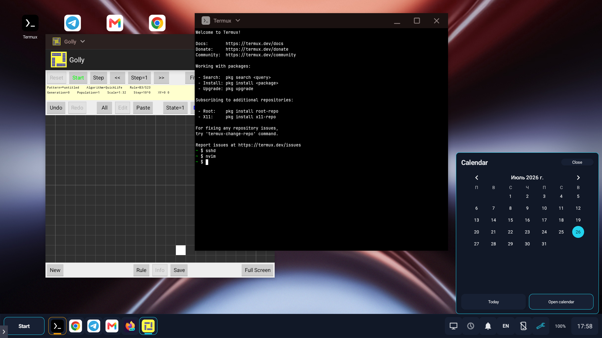
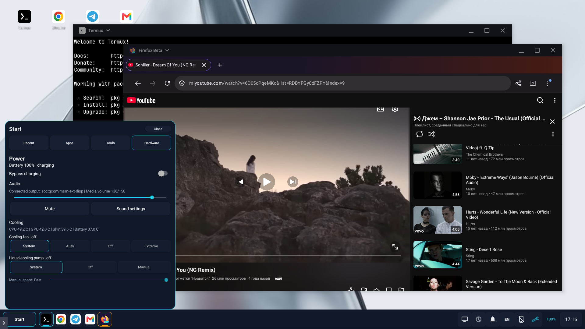
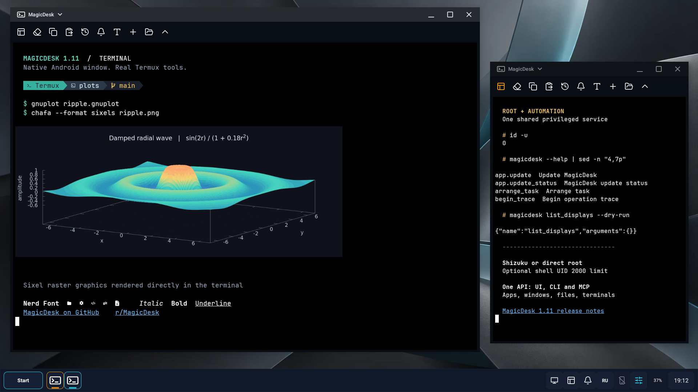
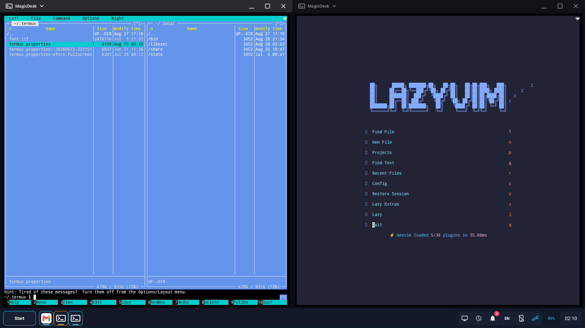
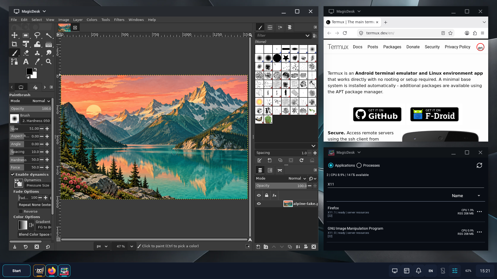

# MagicDesk

**An open-source Android workstation.**

MagicDesk combines native Android app windows, Linux graphical applications,
terminals and independent workspaces on multiple displays. Use the phone,
an external monitor, or a computer connected through scrcpy. Files, clipboard,
application launchers and automation connect the same tools whether or not a
managed Desktop is running.

**Android 14+ for the APK; Android 15+ for managed Desktop.**
Privileged features use Shizuku, a compatible provider such as Shevery, or
optional direct root. Termux terminals and Termux-hosted Linux graphics can
work without any privileged service or managed Desktop.

[Latest release](https://github.com/mekhontsev/magicdesk/releases/latest) |
[Development APK](https://github.com/mekhontsev/magicdesk/releases/download/development/MagicDesk-development.apk) |
[Getting started](docs/getting-started.md) |
[Documentation](docs/README.md)

[Reddit r/MagicDesk](https://www.reddit.com/r/MagicDesk/) |
[Telegram community](https://t.me/magicdesk_android) |
[Support bot](https://t.me/MagicDeskSupportBot)

This README describes the selected branch. The stable APK may not include every
feature below; use its release notes for that version and the development APK
to try unreleased changes. See [downloads and channels](#downloads).

[Desktop](#native-android-desktop) |
[Terminals and tools](#tools-without-desktop) |
[Linux and Shroot](#linux-applications) |
[Displays](#displays-and-portable-workspaces) |
[Setup](#requirements-and-setup) |
[Support](#community-and-support)

[Watch the demo (1080p60)](https://youtu.be/zAHU_0M1ShU): Android and Linux apps
running locally on a REDMAGIC phone over HDMI, including Freeciv from
Ubuntu/PRoot and a full Xfce desktop.



## One Connected Workspace

- **Independent screens:** keep separate workspaces on the phone, external and
  virtual displays, each with its own applications, Start and taskbar.
- **Android and Linux together:** native Android tasks, individual X11/Wayland
  applications, whole Linux desktops and terminals share the workspace.
- **Tools without Desktop:** open Files, Start, terminals and Linux applications
  as ordinary Android windows without replacing your launcher or setting up
  managed Desktop.
- **Shared content:** use a real Desktop folder, clipboard, drag and drop,
  Android sharing and MIME-aware command launchers.
- **Customization:** per-app scale, native JSON themes, configurable panels,
  wallpapers and optional Linux shell components.
- **Automation:** the built-in CLI and authorized MCP clients use the same
  services as the interactive UI.

## Native Android Desktop

Applications remain real Android tasks. Android and WMShell own their rendering,
native captions, input and lifecycle. Shared Android mechanisms provide the core;
focused firmware and SoC adapters add optional capabilities.

Resize, snap, maximize, restore and move tasks between displays. True fullscreen
is separate from a maximized window. Taskbar, overview and Alt+Tab switch exact
tasks without recreating Activities. Start includes search, pins, app actions,
widgets, notifications, media controls and capture tools.

Every Start has a destination selector: **Current** launches on its own screen.
Choose app-default placement, a Desktop window, Desktop fullscreen, or an
independent fullscreen application. **Apps** opens the same Start without
Desktop. Opening an app does not redirect mouse or keyboard input.

MagicDesk acquires HOME for managed Desktop and restores the previous role after
the last Desktop closes. **Close desktop** releases surviving applications as
independent fullscreen tasks on the same live display; it does not remove that
display or end retained terminals and graphics sessions. A disconnected direct
display returns its tasks to the phone.



### Per-App DPI

Choose **App scale > Custom** in an application's Desktop context menu.
**Interface scale** ranges from 50% to 200% of the display density; **System**
removes the override. Saved profiles also appear in
**Settings > Application profiles**.

The preference follows managed windows through snap, maximize and fullscreen.
Returning to ordinary phone use removes the active override but retains the
saved preference. This changes Android density, not monitor resolution, and
cannot create a layout the application does not implement.

## Native Appearance

Choose a bundled style in **Settings > Appearance**, then keep or cancel its
live preview. Configure panels, floating docks, Start layout, colors, fonts,
transparency, blur and motion, with optional per-workspace overrides.

Wallpapers support static images, animated WebP/GIF, silent video and configurable
AGSL shaders. Import/export themes as JSON or resource ZIPs. Styles apply to
MagicDesk, not third-party applications; Linux light/dark propagation and the
temporary Android-wide Desktop theme are separate controls.

The interface supports eight languages. **App language** changes MagicDesk's
language without changing Linux applications.

See [appearance and theme format](docs/appearance.md) and
[Linux appearance](docs/linux-appearance.md).

## Tools Without Desktop

Use **Apps** in Phone Control Panel to open tools on the phone or another allowed
display. The terminal button beside Settings opens the shared session picker;
**Apps > Terminal sessions** uses Start's selected destination.

### Files And Content

Files supports multiple windows, search, selection, copy, move, rename, delete,
properties, file handlers and Android document import under the selected shell
identity. The default Desktop folder is `/storage/emulated/0/Desktop`.

External applications receive scoped content-URI grants for selected files,
never the shell identity. Files, terminals, Desktop and Android sharing use the
same content model. Full work-profile and Private Space support remain unverified
or incomplete; profile-qualified identities alone do not establish that support.

### A Full Terminal, With Or Without Desktop

Interactive PTYs support editors, file managers and CLI tools, with ANSI colors,
scrollback, alternate screens and terminal mouse reporting. Android-shell and
Termux sessions share the renderer, controls and automation API.



- Bundled JetBrains Mono Nerd Font, per-window size, pinch and Ctrl+wheel zoom.
- Static Sixel and inline Kitty graphics, including placeholders through tmux.
- Clickable links, titles, notifications, progress and OSC-marked command output.
- Persistent Android-shell recall through bundled upstream mksh.
- Touch scrolling, selection handles, Android keyboard resizing and paragraph copy.
- One picker for retained shell/Termux PTYs and discovered tmux sessions.
- Session files and folders from Android's picker, camera or clipboard, with
  quoted paths for shell and supported guest sessions. Delete copies individually
  or end their session to remove them together.

Closing an ordinary terminal window detaches it; explicitly ending the session
terminates its programs. Closing a managed tmux window releases its client, not
the tmux server. Local PTYs do not survive MagicDesk process death or APK
replacement; independently running tmux sessions can be attached again.

Termux windows use Termux's own UID, packages and shell. Termux is optional for
ordinary Console, and MagicDesk cannot import an existing Termux tab's PTY.



See [terminal integration](docs/terminal-integration.md) for protocols, history,
image support and session lifetime.

### Task Manager

**Applications** groups Android tasks, retained terminals, tmux and X11/Wayland
sessions. **Processes** shows CPU, resident memory, process trees and filtering.
Return to a window or end a session explicitly. Graphics sessions remain listed
without a viewer; their resource figures describe the server, not every guest
process. Available details depend on the service's actual permissions.

## Linux Applications

The embedded X11 server and Wayland compositor host individual applications or
whole desktops. Programs can come from Termux, Shroot, PRoot or a prepared
chroot. No separate Termux:X11 APK is needed.



### Using Your Existing Desktop Mode

Keep Samsung DeX or another compatible Android desktop shell and use MagicDesk
for Termux terminals and Linux applications. Open MagicDesk on that display,
choose **Apps**, and keep **Current** as the destination. Do not start MagicDesk
Desktop for this workflow. Android's host desktop manages the ordinary windows;
compatibility still depends on its display and input policy.

### Installed Apps In Start

Start discovers installed `.desktop` files; no manual shortcut is needed when
a package supplies one. Shroot entries come from registered environments.
For Termux applications, enable Termux external commands, grant MagicDesk
`RUN_COMMAND`, and install `xkeyboard-config` plus your graphical applications.
Use **Refresh** after installing packages.

Choose the destination and window mode as for Android applications. Launching an
existing entry returns to its window; **New window** requests another instance,
subject to the application's rules. **Add to Android launcher** exports an
installed Linux entry as a small APK shortcut, with Android confirmation.

X11 and Wayland share Android clipboard/file exchange, audio, interface scaling
and window hosting. Supported dialogs and popups can extend beyond their parent
in managed Desktop. An individual application's normal close preserves save
confirmation; force close is separate.

See [desktop entries](docs/desktop-entries.md), [audio](docs/audio.md),
[X11](docs/x11.md) and [Wayland](docs/wayland.md).

### Whole Linux Desktops Too

**Linux graphics** manages retained sessions and their viewers. X11 hosts a
window manager and screen; Wayland hosts a nested compositor. Closing a desktop
viewer retains the Linux session; **Stop** ends it. When a Linux desktop lives on
a virtual display, return through its display viewer in Android Recents rather
than a duplicate internal graphics window. Retained sessions are not saved
across MagicDesk process death or a phone reboot.

For a whole Linux desktop outside managed Desktop, select its display with
**Control input**. With MagicDesk's Accessibility key filter enabled, physical
keyboard chords such as **Alt+Tab**, **Alt+F4** and **Super/Win** go to Linux.
**Ctrl+Alt+Tab** remains the host display switch; power and volume remain Android
controls. Individual Linux windows inside managed Desktop keep MagicDesk's
window shortcuts.

**New command app** can create application, terminal or desktop launchers for
Termux/PRoot, Shroot, or an explicitly prepared root chroot. Custom entry scripts
must preserve the graphical and content-bridge contract.
See [custom launchers](docs/desktop-entries.md#custom-linux-entry-scripts).

### Linux With Shroot

**[Shroot](docs/shroot.md) runs ARM64 Linux userspace on Android's existing
kernel without Android root, a VM, Termux or PRoot.** The normal executor is
Android shell UID 2000, supplied by Shizuku or Shevery.

Its userspace syscall engine supplies supported filesystem, credential,
namespace and networking interfaces missing from the host's kernel configuration
or shell permissions. It neither installs a guest kernel nor changes SELinux.

Verified scenarios include:

| Area | Scope |
| --- | --- |
| Distributions | glibc/musl, package managers, independent environments, OCI layers and copy-on-write storage |
| Services | systemd as guest PID 1, user managers, socket/timer activation, OpenRC and runit lifecycle |
| Containers | Docker Engine, Podman, LXC and systemd-nspawn, overlay storage, nested boot and machinectl lifecycle on systemd distributions |
| Image builds | BuildKit multistage builds, cache reuse/invalidation, cache/secret mounts and exported-image execution |
| Networking | Routed and bridge IPv4/IPv6, supported nftables filtering/NAT, TCP/UDP publication and container peers |
| Virtual machines | QEMU TCG kernel/initrd boot and libvirt-managed start, pause/resume and shutdown; not a KVM claim |
| Application sandboxes | Stock Chromium and Bubblewrap workflows with their filters retained, not `--no-sandbox` |
| Packaged applications | Selected Flatpak and Snap browser workflows, FUSE-backed document portals; Snap runs with reduced confinement, not strict AppArmor isolation |
| Filesystem restrictions | Supported Landlock ABI 1 policies, including pacman's filesystem sandbox |
| Development | Compilers, GDB/LLDB/gdbserver, strace and VS Code workflows |

Coverage is [per distribution and scenario](native/guest-exec-lab/validation-matrix.md),
not a guarantee that every service or package works. Packages come from the guest;
the installer does not build missing container engines for users. Docker and
Podman have [documented launch requirements](docs/shroot.md#services-and-containers).
Logical resource limits remain subject to Android's physical ceilings.

Shroot's default lazy SVC entry accelerates eligible calls in unmodified ARM64
programs, including stock glibc, musl and Go binaries, without changing their
files. **No libc compilation, loader replacement or extra container layer is
needed.** Shroot Base is the seccomp/ptrace fallback for unsupported sites and
application-filtered execution, and can be selected explicitly for diagnosis.
See [acceleration](docs/shroot.md#syscall-acceleration).

The minimum kernel is **Linux 5.15**, with actual capability checks under the
selected executor. Failure leaves independent MagicDesk tools available.

**Shroot is experimental, not a security boundary for untrusted code.** Guest
permissions, mount policies, supported Landlock rules and process/IPC separation
enforce real restrictions, and application seccomp filters remain in the kernel.
Unadapted calls and inherited descriptors retain host authority; logical cgroups
do not enforce native CPU, memory or device limits. Snap's reduced-confinement
mode is not AppArmor enforcement. Use trusted images and programs.
See [coverage and limits](docs/shroot.md#coverage-and-limits).

#### Performance

Alpine ARM64 on one Android phone. **Relative elapsed time: chroot = 1.000x;
lower is better.**

| Workload | chroot | PRoot | Shroot |
| --- | ---: | ---: | ---: |
| `stat` | 1.000x | 62.892x | 5.109x |
| Open / close files | 1.000x | 47.908x | 7.292x |
| Create / close / rename / delete files | 1.000x | 11.785x | 3.300x |
| `fork/exec/wait` | 1.000x | 5.469x | 8.374x |
| Build SQLite | 1.000x | 1.004x | 1.049x |

[Methodology and measured results](docs/shroot-benchmarks.md#readme-comparison).

#### Install Linux

Run in MagicDesk's **Shell** console. Use `main` with the stable APK, or change
`channel` to `develop` with the development APK:

```sh
channel=main
magicdesk download "https://raw.githubusercontent.com/mekhontsev/magicdesk/$channel/scripts/install_linux.sh" ~/install_linux.sh
sh ~/install_linux.sh
```

For an older APK, use its release tag as `channel` to obtain the matching script.
Download before executing so the installer can read your answers; do not pipe
the download into `sh`.

The current branch's recipes cover Debian, Ubuntu, Alpine, Fedora, Arch Linux
ARM, openSUSE, openKylin, Deepin, Manjaro ARM, Void, Armtix, NixOS and SteamOS
ARM64. Choose an environment name, applications or a desktop, and optional
graphics preparation. New installations use the current Android locale when it
has an unambiguous Linux mapping; resume retains the guest locale. Compiler
parallelism defaults to four jobs. Source builds and compatibility vary by recipe.

**Current network** saves the selected executor's Android DNS addresses once;
it does not follow later network changes. DNS remains editable inside Linux.
See [network choices and resume](docs/shroot.md#linux-installer).

NixOS prepares and activates a NixOS system generation. Its Plasma X11 and Wayland
launchers have HDMI checks with Zink/Turnip, keyboard input and close/reopen;
broader application coverage remains incomplete. SteamOS uses Valve's ARM64
recovery userspace, not a guest kernel; this does not imply compatibility with
every Steam game. See the [recipes and image sources](docs/shroot.md#linux-installer)
and [per-distribution evidence](native/guest-exec-lab/validation-matrix.md).

After installation, use **Apps** for individual programs and installed desktop
entries, or **Terminal sessions > New session > Shroot environments** for a
login shell. You can also run `shroot login NAME`. No managed Desktop or repeated
installation is required. See [installation and resume](docs/shroot.md#linux-installer).

### Linux Graphics Acceleration

The optional Turnip recipe builds Mesa inside the Linux environment for
supported Adreno GPUs with accessible KGSL. Depending on the desktop profile,
the recipe also builds compatible KWin or Weston components. Zink supplies OpenGL
over Vulkan; the embedded X11/Wayland host presents the result through Android. This does
not replace Android's graphics driver or require managed Desktop.

Software rendering remains available. GPU admission uses capability probes,
not just the GPU name or kernel version. An APK update does not rebuild an
installed environment's Mesa: use the installer's resume option when updating
that stack. Hardware composition, video decoding and game compatibility are
separate capabilities. See [GPU setup](docs/shroot.md#graphics-drivers) and
[graphics integration](docs/graphics.md).

Flatpak and Snap GPU integration reuses that Mesa through local driver
extensions. An incompatible Flatpak runtime may need an explicitly requested
SDK build; the installer does not automatically build a second Mesa.
See [Flatpak GPU drivers](docs/graphics.md#flatpak-gpu-drivers).

Shroot graphical sessions also receive supported Android gamepads, including
buttons, axes, hotplug and rumble, through a launch-scoped bridge. Input follows
the focused host window. See [gamepad support and limits](docs/gamepads.md).

### Linux Shell Components

An explicitly bound graphical session can contribute X11 dock/desktop windows
or Wayland layer-shell panels to a managed Desktop. Supported panels share work
areas and can control managed Android/Linux tasks through foreign-toplevel
management. **Separate** releases the binding without stopping the session.

Whole Linux desktops keep their panels inside their viewer. See
[shell layout](docs/shell-layout.md) and the
[Waybar example](scripts/examples/waybar/README.md).

## Shizuku Or Direct Root

The default manager list is
`com.hamondev.shevery;moe.shizuku.privileged.api`.
MagicDesk selects the first installed package at startup; it does not switch
providers during a session. Existing saved lists are retained. Configure the
semicolon-separated list in **Settings > Integrations**, then Exit and reopen.
See [provider setup](docs/getting-started.md#install).

Rooted devices may instead select **Privileged service > Root (su)**.
Both transports start the same service. **Limits > Maximum access** chooses
Root, Shell (default UID 2000), or App only. Root does not elevate a shell
provider; Shell restricts a root-backed provider. App only skips privileged
startup while authorized Termux tools remain independent.

Backend, package-list and limit changes apply on the next app start. See
[privilege boundaries](docs/privilege-modes.md).

## MagicDesk On A Computer With scrcpy

Create a MagicDesk virtual display, then view that existing display from a
computer with scrcpy. Replace `3` with its displayed ID:

```sh
scrcpy --display-id=3 --mouse-bind=++++ --shortcut-mod=rctrl
```

Applications still run on Android; scrcpy supplies video/input and has its own
connection requirements. This also works with independent tools without Desktop.
See [display setup](docs/getting-started.md#choose-or-create-a-display).

## Displays And Portable Workspaces

Phone Control Panel lists physical, wireless and owned virtual displays.
Displays, viewers and Desktop sessions have independent lifetimes.

### Portable Workspaces And Parking

A direct Desktop lives on its monitor's Android display. A portable Desktop
lives on a retained virtual display, shown through a fullscreen viewer.

Choose **Start portable desktop here** on the connected output. Disconnecting
the monitor or choosing **Stop showing** parks that live workspace without
moving or relaunching its applications. Reconnect and use **Show another
display...** to show it again. **Control input** separately selects the source
for phone-connected keyboards and mice.

Parking is not persistence across app death. Do not use **Close desktop**,
**Remove display** or **Exit MagicDesk** to park a workspace.

### Viewing And Switching Screens

**Show another display...** shows a retained source on an output.
**Display Viewer** can also open as an ordinary application window.
With the Accessibility key filter active, **Ctrl+Alt+Tab** switches picture and
input together without moving applications. Ordinary viewer opening does not
claim input.

| Action | What remains |
| --- | --- |
| Close viewer / Stop showing | Source display, applications and Desktop |
| Close Desktop | Display, retained services and surviving independent app tasks |
| Remove owned display | Other displays and their sessions |
| Exit MagicDesk | Saved files/settings; owned live services and displays end |

Physical and foreign displays are never removed by MagicDesk. See
[getting started](docs/getting-started.md#choose-or-create-a-display).

## Automation

The optional MCP server and built-in `magicdesk` CLI share the UI's services:
state/events, display and window control, Android actions, terminals, graphics,
files, clipboard, themes, dialogs, notifications, APK updates and self-tests.
They work independently of Desktop where the operation permits it.

Linux sessions also expose [semantic UI automation](docs/automation.md#linux-scope)
through AT-SPI2, [typed D-Bus access](docs/automation.md#typed-d-bus), exact-argument
application launches and persistent guest consoles. Native Termux, Shroot and
PRoot use the same interface where guest services support it. Accessibility
activation has a separate opt-in; application flags remain explicit, and
application sandboxes are not disabled.

MCP is disabled by default. Local and optional network listeners have separate
tokens and grants; the full command catalog remains discoverable even when a
service is unavailable. The CLI needs neither an enabled MCP server nor Python.
Android App Functions and the external command API are separate opt-ins.

See [automation](docs/automation.md) and [external commands](docs/run-command.md).

## Downloads

- [Stable releases](https://github.com/mekhontsev/magicdesk/releases/latest):
  numbered APKs and their version-specific notes.
- [Development APK](https://github.com/mekhontsev/magicdesk/releases/download/development/MagicDesk-development.apk):
  rolling `develop` build published after required CI passes. It uses the normal
  package/signing identity, not MagicDeskTest, and can be less stable. It updates
  the installed MagicDesk rather than installing a separate application.

Development and external PRs target `develop`; verified releases use `main`.
See [contribution workflow](CONTRIBUTING.md#branches-and-releases).

## Requirements And Setup

| Use | Additional requirements |
| --- | --- |
| Settings, appearance, display inventory | Ordinary app access |
| Termux terminals and graphics | Termux external commands, `RUN_COMMAND`; graphics also need XKB data |
| Files, shell, privileged capture and actions | Authorized shell/root service and operation-specific capabilities |
| Shroot | ARM64, executable storage, Linux 5.15+ and required guest capabilities |
| Managed Desktop | Android 15+, privileged service, setup and working framework windowing |
| External output | Hardware/firmware exposing a usable Android secondary display |

Install the APK, open Phone Control Panel and configure only the integrations
you need. Use **Apps** or the terminal picker for independent tools. For managed
Desktop, complete **Settings > Device setup**, then select the display and
**Start desktop**. Reboot only if setup requests it, and restart Shizuku afterward.

Follow [Getting started](docs/getting-started.md) for the complete sequence.
Android 14 has partial shared-service device coverage; Linux graphics on that
release still need verification. See [compatibility](docs/compatibility.md) and
[API boundaries](docs/runtime-api-levels.md).

## Input And Optional Features

**Control input** routes physical Android keyboards and mice independently of
Desktop. Android retains layouts, repeat, pointer acceleration and hover.
The optional phone touchpad supplies a relative mouse; the normal Android IME
handles text. **Show keyboard on app display** requests the IME beside the app,
subject to firmware and keyboard support.

Desktop shortcuts and independent Linux-desktop key forwarding use the shared
key-only Accessibility service while their selected input target is active.
Android 14 external mouse routing needs a usable input viewport and matching
system pointer target; a visible cast display alone does not prove input support.

Phone-screen power, output timing, charge separation, cooling and recording audio
are separately probed optional capabilities. Their absence does not disable
unrelated tools.

## Keyboard Shortcuts

| Shortcut | Action during Desktop |
| --- | --- |
| `Win+D` | Show desktop / restore its previous layout |
| `Win+Up` | True fullscreen |
| `Win+Down` | Restore; press again to minimize |
| `Win+Left` / `Win+Right` | Snap to a half |
| Hold `Win` after Left/Right, then `Up` / `Down` | Corner, half or opposite corner |
| `Alt+Tab` / `Alt+Shift+Tab` | Switch exact tasks |
| `Ctrl+Alt+Tab` | Switch displayed screen and input |
| `Alt+F4` | Close active task |
| `Win+Backspace` | Android Back |
| `Win+L` | Lock phone |
| `Win+N` / `Win+Q` | Notifications / Quick controls |
| `Win+I` | Settings |
| `Win+Print Screen` | Screenshot |
| `Win+Shift+Print Screen` | Start/stop recording |
| `Ctrl+Space` | Next configured hardware-keyboard layout |
| `Win+/` | All shortcuts |

Pointer equivalents are available in taskbar/window context menus and Quick
controls. These are managed Desktop bindings; an independently controlled
[whole Linux desktop](#whole-linux-desktops-too) receives its own window shortcuts.

## Security

Use [private security reporting](https://github.com/mekhontsev/magicdesk/security/advisories/new)
for vulnerabilities, not public issues or the support bot.

Files and shell commands retain the selected service identity; Termux retains
its own. MagicDesk does not patch SystemUI or install a kernel module.
Shell and input automation grants allow broad control, not a category-isolated
sandbox. Accepted work may continue after a grant is revoked.

Network MCP uses HTTP, not TLS: use a trusted network or a protected tunnel,
never direct Internet exposure. External command access has its own disabled-by-
default opt-in and Android permission. Grant it only to trusted applications.

See [Security](SECURITY.md) and [Privilege boundaries](docs/privilege-modes.md).

## Community And Support

Use [r/MagicDesk](https://www.reddit.com/r/MagicDesk/) and
[Telegram](https://t.me/magicdesk_android) for discussions and user setups.
For reproducible defects, send complete Diagnostics output and exact steps to
[GitHub issues](https://github.com/mekhontsev/magicdesk/issues) or the support bot.

### AI-Assisted Support

[MagicDesk Support Bot](https://t.me/MagicDeskSupportBot) accepts reports and
follow-up test results in a private chat. GitHub Copilot can investigate a case,
ask questions and propose a test APK. Each candidate links its exact source,
build and checksum.

MagicDeskTest uses a separate package/signing key and is not an official release
or a verified fix. Installation is manual and merging still requires review.
Do not send secrets: generated source may contain report details. See
[Telegram support](docs/telegram-support.md) for submission and privacy rules.

## Diagnostics And Development

Reports omit user files, account data, notification contents and the installed
app catalog, but logs can contain filenames and package names. Review before
sending. Interactive self-tests certify their exact scenarios, not every firmware.

Build prerequisites and device checks are in [Contributing](CONTRIBUTING.md):

```sh
git submodule update --init --recursive
./gradlew verifyDevelopment
```

Native helpers currently target ARM64. Host builds do not replace device checks.

> Development uses iterative AI-assisted implementation and hands-on device
> testing. Independent review is especially important for privileged integration.
> See the [device-porting workflow](docs/ai-assisted-device-porting.md).

## Documentation

The [documentation index](docs/README.md) separates user guides, interfaces,
architecture and verification. Start with:

- [Getting started](docs/getting-started.md) and [workstation tools](docs/workstation-tools.md)
- [Linux installation and Shroot](docs/shroot.md)
- [Terminal integration](docs/terminal-integration.md)
- [X11](docs/x11.md), [Wayland](docs/wayland.md) and [graphics](docs/graphics.md)
- [Automation](docs/automation.md) and [desktop entries](docs/desktop-entries.md)
- [Architecture](docs/architecture.md) and [compatibility](docs/compatibility.md)
- [Device coverage](docs/testing-backlog.md) and [Shroot matrix](native/guest-exec-lab/validation-matrix.md)

## Project

- Author: [Dmitry Mekhontsev](https://github.com/mekhontsev)
- Package: `io.github.mekhontsev.magicdesk`
- Minimum APK SDK: 34; managed Desktop: 35; target SDK: 37
- License: [GNU GPLv3](LICENSE); see [licensing](docs/licensing.md) and
  [third-party notices](THIRD_PARTY_NOTICES.md).
